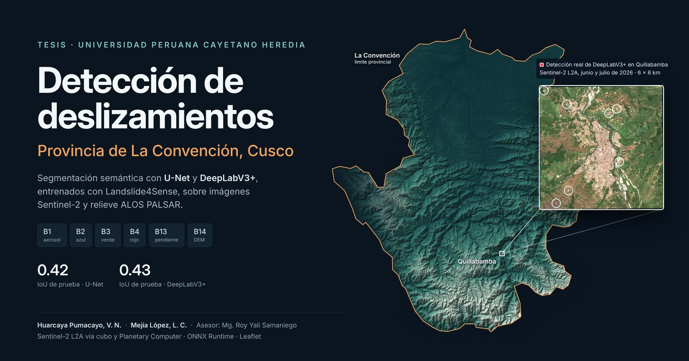
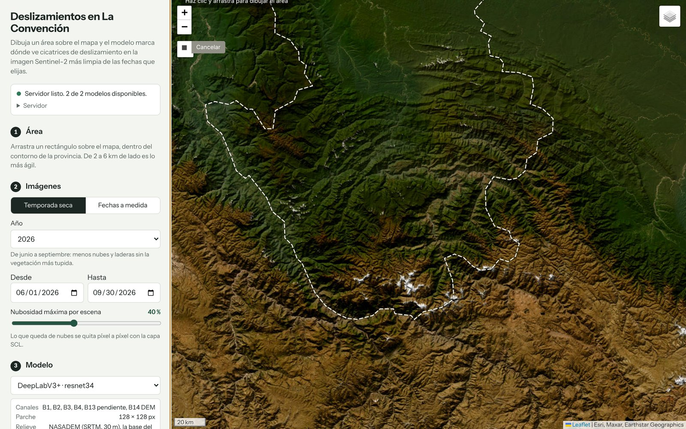
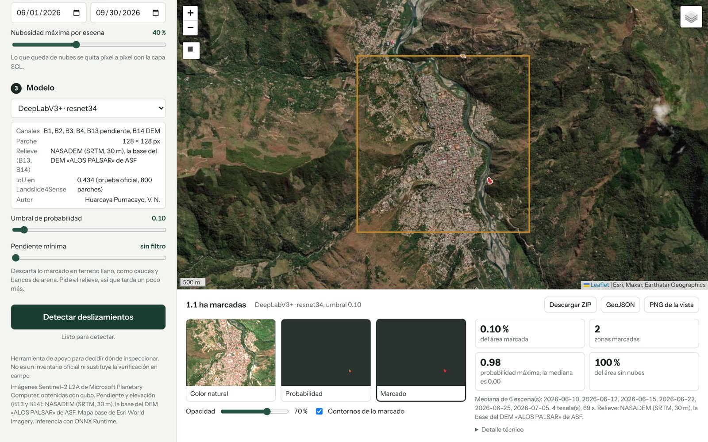
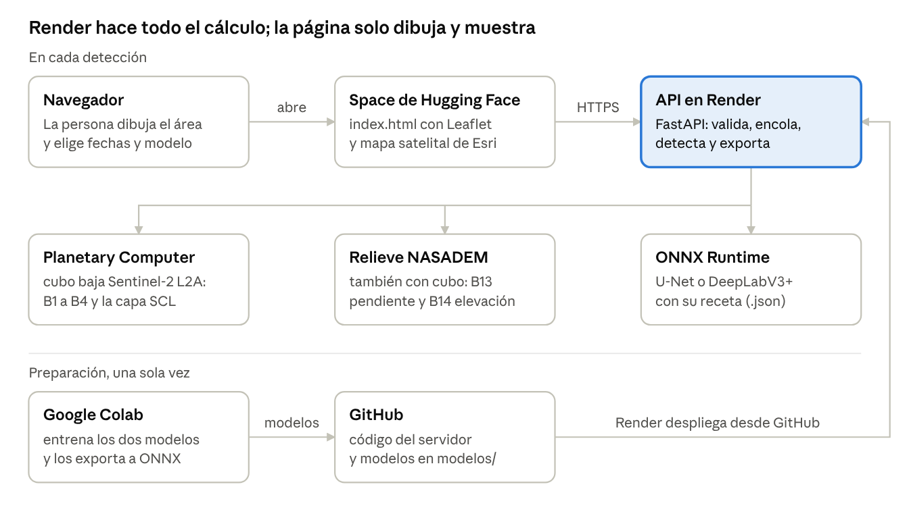
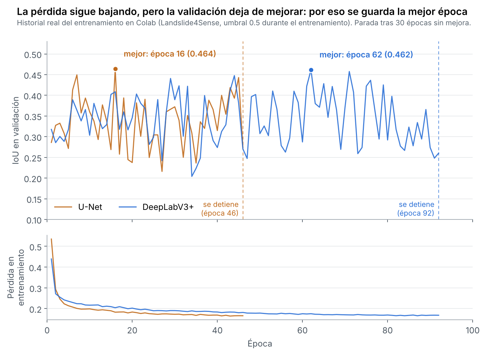
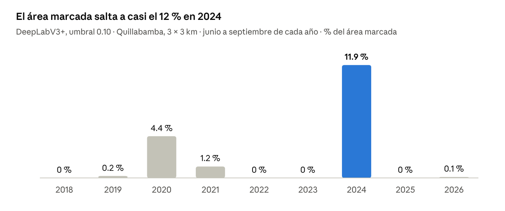

# Detección de deslizamientos en La Convención, Cusco



Este repositorio tiene el servidor de nuestra tesis en la Universidad Peruana Cayetano Heredia: **«Sistema de segmentación semántica basado en imágenes Sentinel-2 para la identificación de deslizamientos de tierra en La Convención, Cusco»**.

**Probar la aplicación:** https://nikolaivictor-deslizamientos-laconvencion.static.hf.space

| Enlace | Qué hay ahí |
|---|---|
| [Aplicación web](https://nikolaivictor-deslizamientos-laconvencion.static.hf.space) | El mapa para dibujar un área y detectar |
| [Space en Hugging Face](https://huggingface.co/spaces/NikolaiVictor/deslizamientos-laconvencion) | Los archivos de la página |
| [API en Render](https://deslizamientos-laconvencion.onrender.com) | El servidor que hace los cálculos |
| [Documentación de la API](https://deslizamientos-laconvencion.onrender.com/docs) | Para probar cada ruta desde el navegador |
| [Este repositorio](https://github.com/VictorNikolai/Proyecto_Tesis_Deslizamiento) | Código del servidor, modelos y cuaderno de entrenamiento |

## Contenido

1. [El problema](#el-problema)
2. [Qué hace el sistema](#qué-hace-el-sistema)
3. [Cómo funciona](#cómo-funciona)
4. [Herramientas que usamos y para qué](#herramientas-que-usamos-y-para-qué)
5. [Datos de entrada](#datos-de-entrada)
6. [Cómo entrenamos los modelos y por qué así](#cómo-entrenamos-los-modelos-y-por-qué-así)
7. [Resultados de los modelos](#resultados-de-los-modelos)
8. [Cómo leer un resultado en la página](#cómo-leer-un-resultado-en-la-página)
9. [Problemas que resolvimos en el camino](#problemas-que-resolvimos-en-el-camino)
10. [Requisitos de la tesis y cómo se cumplen](#requisitos-de-la-tesis-y-cómo-se-cumplen)
11. [La API](#la-api)
12. [Estructura, despliegue y uso local](#estructura-del-repositorio)
13. [Limitaciones](#limitaciones)
14. [Posibles mejoras](#posibles-mejoras)
15. [Preguntas frecuentes](#preguntas-frecuentes)

## El problema

La Convención tiene laderas muy empinadas entre los Andes y la selva, y lluvias fuertes buena parte del año. Los deslizamientos son frecuentes y cortan carreteras, cultivos y caminos entre poblados.

Las imágenes satelitales gratuitas como Sentinel-2 permiten ver dónde se movió una ladera, pero revisarlas a mano es lento. Hay que buscar la imagen sin nubes, juntarla con el relieve y mirar kilómetro por kilómetro, en una provincia de unos 30 000 km².

## Qué hace el sistema

El sistema hace esa revisión de forma automática para el área y las fechas que uno elija:

1. Se dibuja un rectángulo sobre el mapa de la provincia y se elige un año o unas fechas.
2. El servidor busca las imágenes Sentinel-2 de esas fechas, quita las nubes y se queda con la imagen más limpia.
3. Le suma la pendiente y la elevación del terreno.
4. Un modelo de segmentación (U-Net o DeepLabV3+) marca, píxel por píxel, dónde ve cicatrices de deslizamiento.
5. El resultado aparece sobre el mapa y se descarga en GeoTIFF y GeoJSON para trabajarlo en QGIS.



*Pantalla inicial: el mapa satelital con el contorno de La Convención. Solo se puede detectar dentro de la provincia.*



*Una detección real con DeepLabV3+ en Quillabamba, temporada seca de 2026. Abajo: color natural, probabilidad, lo marcado y el resumen.*

No reemplaza una visita de campo ni es un inventario oficial. Sirve para decidir dónde conviene ir a mirar.

## Cómo funciona



La página web solo muestra el mapa y los resultados. Todo el cálculo lo hace el servidor en Render. Una detección de 3 × 3 km tarda entre uno y dos minutos; una de 8 km, entre tres y cinco.

## Herramientas que usamos y para qué

| Herramienta | Para qué la usamos |
|---|---|
| Python 3.12 | Lenguaje de todo el proyecto |
| Landslide4Sense | Dataset con deslizamientos etiquetados para entrenar los modelos |
| Google Colab (GPU T4) | Entrenar los modelos sin tener una GPU propia |
| Google Drive | Guardar los modelos entrenados y sus resultados |
| PyTorch y segmentation-models-pytorch | Armar y entrenar U-Net y DeepLabV3+ con ResNet-34 |
| ONNX y ONNX Runtime | Guardar los modelos en un formato estándar y correrlos en el servidor sin PyTorch |
| cubo | Pedir recortes de Sentinel-2 y del DEM por coordenadas y fechas |
| Microsoft Planetary Computer | Catálogo gratuito de donde salen Sentinel-2 L2A y NASADEM |
| stackstac, xarray, dask y pystac-client | Los usa cubo para buscar y leer las imágenes |
| NumPy | Cálculos con las imágenes: mediana, pendiente, normalización |
| rasterio, pyproj y shapely | GeoTIFF, cambios de proyección, polígonos y el contorno de la provincia |
| Pillow | Imágenes PNG para ver el resultado en el mapa |
| FastAPI, Uvicorn y pydantic | La API: recibir pedidos, validarlos y responder |
| Leaflet 1.9.4 y Leaflet.draw | El mapa de la página y la herramienta para dibujar el rectángulo |
| Esri World Imagery | El mapa satelital de fondo |
| GitHub | Guardar el código y los modelos; Render despliega desde aquí |
| Render | Tener la API en internet gratis |
| Hugging Face Spaces | Publicar la página web |
| Playwright | Probar la página en un navegador de forma automática |
| QGIS | Abrir y revisar los GeoTIFF y GeoJSON que entrega el sistema |

## Datos de entrada

Los modelos reciben seis canales, los mismos que tiene Landslide4Sense:

| Canal | Qué es | De dónde sale |
|---|---|---|
| B1 | Aerosol costero | Sentinel-2 L2A, con cubo |
| B2 | Azul | Sentinel-2 L2A, con cubo |
| B3 | Verde | Sentinel-2 L2A, con cubo |
| B4 | Rojo | Sentinel-2 L2A, con cubo |
| B13 | Pendiente (ALOS PALSAR) | calculada del DEM; grados / 20.292 |
| B14 | Elevación (ALOS PALSAR) | DEM; metros / 772.82 |

Sobre el relieve: el DEM «ALOS PALSAR» de 12.5 m que usa Landslide4Sense lo distribuye el Alaska Satellite Facility, pero no sale del radar PALSAR. Es SRTM de 30 m remuestreado. Por eso usamos **NASADEM**, la versión revisada de SRTM, que también se pide con cubo. En `render.yaml` se puede cambiar a AW3D30, a Copernicus GLO-30 o a un mosaico armado con los archivos de ASF.

Las constantes 20.292 y 772.82 las medimos en los parches de Landslide4Sense y salieron iguales en entrenamiento, validación y prueba. Las bandas B1 a B4 se dividen por su media en la provincia, guardada en `escala_laconvencion.json`, porque así vienen en el dataset.

## Cómo entrenamos los modelos y por qué así

Entrenamos los dos modelos con el mismo cuaderno (`Entrenar_Modelos.ipynb`) y la misma configuración, para que la comparación entre U-Net y DeepLabV3+ sea justa. Todo lo que sigue sale del historial real guardado en ese cuaderno.

### Qué es una época

Una **época** es una pasada completa del modelo por todos los parches de entrenamiento. Landslide4Sense tiene 3799; con lotes de 16 parches, cada época son 238 pasos en los que el modelo mira un lote, se equivoca y corrige un poco sus pesos.

Una sola época no alcanza: el modelo necesita ver muchas veces los mismos ejemplos para aprender a separar un deslizamiento de un camino o de un río. Pero si se le da demasiadas, empieza a memorizar los parches de entrenamiento y deja de mejorar con parches que no ha visto. Por eso, al final de cada época, se mide el modelo con los 245 parches de validación, que nunca usa para aprender.

### Por qué hasta 100 épocas y paciencia de 30



- **Hasta 100 épocas** es el techo. La tasa de aprendizaje baja poco a poco a lo largo de esas 100 épocas (programación coseno): al inicio el modelo da pasos grandes y al final pasos finos.
- **Paciencia de 30** quiere decir que el entrenamiento se detiene si pasan 30 épocas seguidas sin superar la mejor validación. Es un número alto a propósito: como muestra el gráfico, el IoU de validación salta mucho de una época a otra. La U-Net llegó a 0.449 en la época 7 y cayó a 0.293 en la 12. Con una paciencia corta, de 5 o 10, el entrenamiento se habría cortado antes de encontrar las mejores épocas.
- **Se guarda la mejor época, no la última.** La pérdida de entrenamiento (abajo en el gráfico) sigue bajando hasta el final, pero la validación deja de mejorar. Esa diferencia es la señal de que el modelo empieza a memorizar. Quedarse con la mejor época de validación evita usar un modelo sobreajustado.

| Modelo | Épocas que corrió | Mejor época | Por qué se detuvo | Tiempo en GPU T4 |
|---|---|---|---|---|
| U-Net | 46 | 16 | 30 épocas sin mejorar la de la época 16 | 10 min (unos 13 s por época) |
| DeepLabV3+ | 92 | 62 | 30 épocas sin mejorar la de la época 62 | 17 min (unos 12 s por época) |

A eso se suman unos 2 minutos por modelo para cargar los parches en memoria y unos 10 minutos, una sola vez, para descargar el dataset.

La U-Net encontró su mejor punto muy pronto y DeepLabV3+ siguió mejorando hasta la época 62. Ninguno llegó a las 100, así que el techo no limitó el entrenamiento.

### Las demás decisiones

| Decisión | Qué usamos | Por qué |
|---|---|---|
| Partición de datos | La oficial: 3799 entrenamiento, 245 validación, 800 prueba | Permite comparar con otros trabajos que usan Landslide4Sense, y la prueba queda separada hasta el final |
| Codificador | ResNet-34 con pesos de ImageNet | Empezar con un modelo que ya reconoce bordes y texturas aprende más rápido que empezar de cero con solo 3799 parches |
| Pérdida | Entropía cruzada binaria más Dice, mitad y mitad | Solo el 2.32 % de los píxeles de entrenamiento son deslizamiento. Con entropía cruzada sola, marcar «no hay deslizamiento» en todo ya daría 97.7 % de aciertos; Dice obliga a encontrar lo poco que sí hay |
| Optimizador | AdamW, tasa de aprendizaje 0.0003 | Un optimizador común y estable para estas redes, que además regulariza los pesos |
| Aumento de datos | Giros de 90° y espejo horizontal | Un deslizamiento sigue siéndolo girado; así el modelo ve más variedad sin datos nuevos |
| Normalización | Media y desviación de cada canal, calculadas solo con entrenamiento | Si se calcularan con validación o prueba, esos datos «se filtrarían» al modelo |
| Lote y precisión | 16 parches, precisión mixta | Cabe en la memoria de la T4, y la precisión mixta acelera el entrenamiento en GPU |
| Entrada | La misma función que usa el servidor | El modelo recibe en producción exactamente lo mismo que vio al entrenar |

### Por qué cada modelo tiene un umbral distinto

El modelo no responde «sí» o «no», sino una probabilidad entre 0 y 1 por píxel. El **umbral** es el valor desde el cual se marca como deslizamiento. Con la mejor época de cada modelo probamos umbrales de 0.05 a 0.95 en validación y nos quedamos con el de mayor IoU.

A la U-Net le fue mejor con **0.70** y a DeepLabV3+ con **0.10**. No es un error: cada red reparte sus probabilidades de forma distinta. Que el mejor umbral de DeepLabV3+ sea tan bajo indica que tiende a dar probabilidades bajas incluso donde acierta. Por eso el gráfico de arriba (medido con 0.5 durante el entrenamiento) da valores algo menores que la tabla de resultados, que usa el umbral elegido. En la página se puede mover el umbral para ver más o menos zonas marcadas.

## Resultados de los modelos

| Modelo | Autor | Mejor época | Umbral | IoU validación | IoU prueba | F1 | Precisión | Recall |
|---|---|---|---|---|---|---|---|---|
| U-Net | L. C. Mejía López | 16 | 0.70 | 0.466 | **0.425** | 0.596 | 0.555 | 0.644 |
| DeepLabV3+ | V. N. Huarcaya Pumacayo | 62 | 0.10 | 0.481 | **0.434** | 0.605 | 0.520 | 0.724 |

Estas métricas son sobre los 800 parches de prueba de Landslide4Sense. Para La Convención todavía no hay un inventario etiquetado con el cual medir.

**Cómo leerlas**, con los números de DeepLabV3+:

| Métrica | Qué mide | En palabras |
|---|---|---|
| Precisión 0.52 | De lo que el modelo marca, cuánto es deslizamiento de verdad | De cada 100 píxeles marcados, 52 son deslizamiento |
| Recall 0.72 | De los deslizamientos reales, cuánto encuentra | De cada 100 píxeles de deslizamiento, encuentra 72 |
| F1 0.61 | El equilibrio entre precisión y recall | Una sola nota que castiga si cualquiera de las dos es baja |
| IoU 0.43 | Cuánto se superponen lo marcado y lo real, sobre todo lo que cubren entre los dos | La métrica principal en segmentación; es más exigente que el F1 |

DeepLabV3+ encuentra más deslizamientos (recall 0.72 frente a 0.64), pero marca más cosas que no lo son. La U-Net es más precisa (0.56) y se le escapan más. Para elegir dónde ir a inspeccionar, encontrar más suele ser preferible, aunque eso signifique revisar algunas falsas alarmas.

Cada modelo está en `modelos/` en dos archivos con el mismo nombre: el `.onnx` con la red y el `.json` con su receta (canales, normalización, umbral, rango de valores que vio al entrenar y métricas). Al arrancar, el servidor revisa los pesos y descarta cualquier modelo que no esté entrenado. También volvimos a medir los dos ONNX con el código del servidor y dieron exactamente las mismas métricas que en el entrenamiento.

## Cómo leer un resultado en la página

| Lo que ves | Qué significa |
|---|---|
| Color natural | La imagen Sentinel-2 combinada que usó el modelo, sin nubes |
| Probabilidad | Qué tan seguro está el modelo en cada píxel; más intenso, más probable |
| Marcado | Los píxeles que pasan el umbral; sus contornos se pueden prender o apagar |
| Umbral | Más bajo marca más zonas (y más falsas alarmas); más alto marca menos |
| Pendiente mínima | Borra lo marcado en terreno llano, donde un deslizamiento es poco probable: cauces, bancos de arena, techos |
| Zonas marcadas y hectáreas | Cada zona es un polígono del GeoJSON, con su área |
| Escenas | Las fechas de las imágenes que se combinaron |
| Avisos en rojo | Parte del área tiene nubes, queda fuera de la provincia o tiene alturas que el modelo no vio al entrenar |

Lo recomendable es empezar con el umbral de cada modelo, poner la pendiente mínima en 10° como máximo y revisar cada zona marcada sobre el color natural antes de sacar conclusiones. En Landslide4Sense, el 10 % de los píxeles de deslizamiento está en pendientes menores a 16°: con un filtro de 15° el IoU de DeepLabV3+ baja de 0.434 a 0.418, y con 10° casi no cambia (0.430).

## Problemas que resolvimos en el camino

| Problema | Cómo lo resolvimos |
|---|---|
| Los primeros ONNX del proyecto estaban sin entrenar y daban resultados sin sentido | Revisión de pesos al exportar y al arrancar el servidor |
| La copia de Landslide4Sense tenía archivos vacíos que hacían fallar el entrenamiento | Emparejar cada imagen con su máscara y saltar los archivos vacíos |
| Los dos modelos guardaban sus archivos con el mismo nombre y uno pisaba al otro | Se agregó la arquitectura a la firma de cada archivo |
| El servidor usaba 759 MB y Render gratis solo da 512 MB | Abrir el modelo solo para detectar, leer los pesos desde disco y limitar hilos y caché: quedó entre 251 y 307 MB |
| Con las imágenes de 2026 la descarga fallaba | cubo entregaba un dato de la escena como un solo valor; ahora se repite para cada escena |
| Sin imágenes en las fechas elegidas, la página mostraba un error técnico | La API explica que no hay escenas y sugiere ampliar las fechas o subir la nubosidad |
| Las mallas UTM se veían giradas sobre Leaflet | Las capas PNG se reproyectan a grados antes de mostrarlas |

## Requisitos de la tesis y cómo se cumplen

| Requisito | Cómo se cumple |
|---|---|
| U-Net y DeepLabV3 entrenados con Landslide4Sense | Los dos entrenados con la partición oficial; métricas arriba |
| Aplicación web en Hugging Face | Space estático con la página; el cálculo en Render |
| Funciones como beta-earth | Área en el mapa, año o fechas, nubes quitadas por píxel, teselado con solape, vista previa, descarga con manifiesto y límite de área |
| Mapa inicial en Leaflet satelital | Leaflet 1.9.4 con Esri World Imagery |
| Sentinel-2 B1, B2, B3 y B4 | Descargadas de Sentinel-2 L2A en la fecha pedida |
| Pendiente B13 y DEM B14 de ALOS PALSAR | NASADEM, que es la base del DEM «ALOS PALSAR» de ASF; opción de usar los archivos de ASF |
| Imágenes adquiridas con cubo | cubo para Sentinel-2 y para el DEM |
| Modelos en formato ONNX | Los dos en ONNX, con su receta y verificados |
| La Convención, Cusco | El servidor rechaza áreas fuera de la provincia |

## La API

| Método | Ruta | Para qué |
|---|---|---|
| GET | `/` | Datos del servicio: límites, ámbito y fuente del relieve |
| GET | `/salud` | Comprobar que el servidor responde |
| GET | `/modelos` | Modelos disponibles con su receta y estado |
| GET | `/ambito` | Contorno de la provincia |
| POST | `/trabajos` | Lanzar una detección; devuelve el número de trabajo |
| GET | `/trabajos/{id}` | Avance y, al terminar, el resultado |
| GET | `/trabajos/{id}/zip` | Descargar los resultados |

Ejemplo de pedido:

```json
{
  "sur": -12.88, "oeste": -72.71, "norte": -12.85, "este": -72.68,
  "desde": "2026-06-01", "hasta": "2026-09-30",
  "modelo": "deeplabv3plus", "nubes_max": 40, "pendiente_min": 0
}
```

El ZIP trae `mascara.tif` y `probabilidad.tif` (UTM a 10 m), `deteccion.geojson` con el área de cada zona en hectáreas, tres vistas en PNG y `manifiesto.json`. El manifiesto guarda la huella del modelo, los canales, la fuente del relieve y el identificador de cada escena Sentinel-2 usada, para poder repetir la detección.

La API no acepta áreas fuera de La Convención, rectángulos de más de 8 km de lado, fechas futuras ni fechas anteriores a 2017.

## Estructura del repositorio

```
main.py                       API con FastAPI
nucleo/
  config.py                   parámetros y variables de entorno
  ambito.py                   comprueba que el área caiga en la provincia
  datos.py                    imágenes Sentinel-2 y relieve con cubo
  recetas.py                  arma la entrada igual que en el entrenamiento
  modelos.py                  carga los ONNX y revisa sus pesos
  inferencia.py               recorre el área en parches sin costuras
  procesar.py                 validación y flujo completo de una detección
  exportar.py                 GeoTIFF, GeoJSON, PNG y manifiesto
  trabajos.py                 cola de trabajos en segundo plano
modelos/                      unet y deeplabv3plus (.onnx y .json)
docs/img/                     imágenes de este README
limite_laconvencion.geojson   contorno de la provincia
escala_laconvencion.json      media de cada banda en la provincia
Entrenar_Modelos.ipynb        cuaderno de Colab con el que entrenamos los modelos
render.yaml                   configuración del despliegue en Render
requirements.txt              versiones probadas juntas, para Python 3.12
```

### Cómo se despliega

**API en Render.** Se crea un Blueprint con este repositorio y `render.yaml` configura el servicio solo. Estas variables mantienen el servidor dentro de los 512 MB del plan gratuito y conviene no quitarlas: `UN_MODELO_A_LA_VEZ`, `MALLOC_ARENA_MAX`, `GDAL_CACHEMAX` y `MAX_LADO_KM`. `ORIGENES_PERMITIDOS` dice qué página puede usar la API; aquí es la del Space.

**Página en Hugging Face.** Es un Space de tipo *Static* con `index.html`, `README.md` y `portada.png`. La página ya trae la dirección de la API.

En el plan gratuito, Render apaga el servidor cuando nadie lo usa, así que la primera visita después de un rato tarda alrededor de un minuto.

### Correrlo en una computadora

Con Python 3.12, en PowerShell:

```
py -3.12 -m venv .venv
.venv\Scripts\Activate.ps1
pip install -r requirements.txt
uvicorn main:app --port 8000
```

Después se abre `http://localhost:8000/docs` para probar la API.

### Volver a entrenar

`Entrenar_Modelos.ipynb` se abre en Google Colab con GPU T4 (Entorno de ejecución → Cambiar tipo de entorno). Descarga Landslide4Sense, entrena U-Net y DeepLabV3+ con los seis canales, los exporta a ONNX y los verifica. En total tarda alrededor de 45 minutos. Al final deja en Google Drive los cuatro archivos que van en `modelos/`. El cuaderno que está aquí conserva las salidas de la corrida que produjo los modelos actuales.

## Limitaciones

Los modelos aprendieron con imágenes de otras partes del mundo y en La Convención a veces se confunden. Marcan como deslizamiento techos, suelo desnudo, arena de río o laderas secas y quemadas, sobre todo en temporadas muy secas.



*Mismo rectángulo de 3 × 3 km en Quillabamba, de junio a septiembre de cada año. En 2024 las zonas marcadas caen sobre laderas secas, no sobre cicatrices.*

Además:

- El resultado cambia bastante según el modelo, el umbral y el año. El filtro de pendiente mínima ayuda a descartar terreno llano, pero por encima de 10° empieza a borrar deslizamientos reales.
- Con 10 m por píxel no se ven los deslizamientos pequeños.
- Cerca del 4.4 % de la provincia está sobre los 4000 m, más alto que lo que vio el modelo al entrenar (hasta 3661 m). El sistema avisa cuando un área cae ahí.
- El contorno de la provincia es una versión simplificada del límite oficial. Sirve para controlar dónde se puede detectar, no para medir superficies.

## Posibles mejoras

### Qué tan bien están los modelos hoy

Los dos modelos rinden igual dentro del margen de error. Medido sobre los 800 parches de prueba, con remuestreo para calcular el rango probable:

| Modelo | IoU | Rango probable del IoU | F1 |
|---|---|---|---|
| U-Net | 0.425 | 0.38 a 0.47 | 0.596 |
| DeepLabV3+ | 0.434 | 0.39 a 0.47 | 0.605 |

La diferencia entre ellos (0.009) cabe de sobra en ese margen, así que no se puede decir que uno sea mejor. Como referencia, en la competencia Landslide4Sense 2022 la U-Net de los organizadores llegó a un F1 de 0.599 con las 14 bandas, y el equipo ganador a 0.745. Nuestros modelos quedan al nivel de esa referencia usando solo 6 canales.

Contado por deslizamiento, cada modelo encuentra al menos una parte del 65 % de los 2200 deslizamientos de la prueba. Los que se escapan son sobre todo los pequeños: la mediana de los perdidos es de 10 píxeles, contra 48 de los encontrados. Alrededor de la mitad de las zonas marcadas no toca ningún deslizamiento real.

### Mejoras que ya probamos

| Prueba | IoU | F1 | Resultado |
|---|---|---|---|
| Ensamble: promediar U-Net y DeepLabV3+ (umbral 0.45 elegido en validación) | **0.450** | **0.621** | La mejor; sube 0.016 sobre DeepLabV3+ sin reentrenar |
| Detectar también sobre la imagen en espejo y promediar | 0.435 | 0.607 | Casi no cambia |
| Borrar las marcas de menos de 10 píxeles | 0.435 | 0.606 | Casi no cambia |
| Pendiente mínima de 15° | 0.418 | 0.589 | Empeora: borra deslizamientos reales |

### En los modelos

- **Ofrecer el ensamble en la página.** Es la única mejora medida que sube el resultado. Cada detección tardaría el doble, porque corren los dos modelos uno tras otro.
- **Un inventario de La Convención.** Etiquetar deslizamientos de la provincia, con imágenes de alta resolución y visitas de campo, para medir los modelos donde se van a usar. Revisando unas 50 zonas marcadas ya se tendría una primera precisión local, con un margen de unos 14 puntos.
- **Ajustar los modelos con datos locales.** Con ese inventario, seguir entrenando desde los modelos actuales para que aprendan cómo se ven los suelos, la vegetación y las quemas de la zona.
- **Más bandas.** El infrarrojo (B8, B11 y B12) ayudaría a separar vegetación seca y zonas quemadas de los deslizamientos. Es lo que más separa a los ganadores de la competencia, aunque sale de los seis canales que pide la tesis.
- **Codificadores más grandes** que ResNet-34, que suelen dar algo más a cambio de un modelo más pesado.
- **Elegir mejor la época de la U-Net.** Como su validación varía mucho, elegirla promediando varias épocas o con el umbral óptimo de cada una podría mejorarla un poco.

### En la página

| Mejora | Para qué sirve |
|---|---|
| Imagen de color natural en GeoTIFF dentro del ZIP | Comparar en QGIS cada marca con la misma imagen que vio el modelo |
| Lista de zonas marcadas, ordenadas por área, con coordenadas y enlace al mapa | Revisar zona por zona sin abrir QGIS |
| Descarga en KML | Abrir el resultado en Google Earth o en el celular para ir a campo |
| Comparar antes y después | Detectar en dos periodos y mostrar solo lo que aparece nuevo; quita las falsas alarmas que están todos los años |
| Marcar cada zona como correcta o falsa | Armar desde la página el inventario local para medir la precisión |
| Buscar por lugar y compartir un enlace con el área y las fechas | Uso más cómodo y detecciones fáciles de repetir |
| Capa del inventario de peligros geológicos de INGEMMET | Ver si lo marcado coincide con deslizamientos ya registrados |
| Reporte en PDF de cada detección | Entregar el resultado a una municipalidad o a defensa civil |

## Preguntas frecuentes

**¿Por qué la página tarda la primera vez?**
Render apaga el servidor gratuito cuando nadie lo usa. La primera visita lo despierta y tarda alrededor de un minuto.

**¿Por qué no deja detectar fuera de La Convención?**
Porque los modelos solo se revisaron para esta provincia. Un resultado afuera se vería igual de convincente, pero no tendría respaldo.

**¿Qué fechas conviene usar?**
La temporada seca, de junio a septiembre, tiene menos nubes. En temporada de lluvias puede no haber ninguna imagen limpia.

**¿Por qué marca zonas que no son deslizamientos?**
Suelo desnudo, techos, arena y laderas quemadas se parecen mucho a un deslizamiento en una imagen de 10 m. Poner la pendiente mínima en 10° y revisar sobre el color natural ayuda a descartarlas.

**¿Se puede usar en QGIS?**
Sí. El ZIP trae GeoTIFF en UTM y un GeoJSON con los polígonos, listos para abrir.

## Autores

**Victor Nikolai Huarcaya Pumacayo** (DeepLabV3+) y **Leonardo C. Mejía López** (U-Net).
Asesor: **Mg. Roy Yali Samaniego**.
Universidad Peruana Cayetano Heredia.
